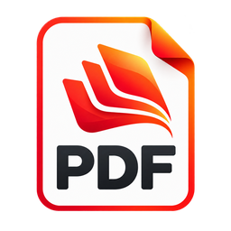

# PdfCraft logo and app icons



The logo is the contributor-supplied glossy red/orange PDF document emblem. The original
1254 × 1254 RGBA PNG is preserved byte-for-byte as `pdfcraft.png`, including its transparency
and framing. Every platform icon is a resized copy, with no tracing or recolouring.

**Provenance:** generated in ChatGPT and supplied by GitHub contributor `4hj7p6nn8c-byte` on
2026-10-10. The contributor confirmed ownership and permission to include it under the project's
`MIT OR Apache-2.0` licence. See [LICENSE.txt](LICENSE.txt).

| File | Use |
|---|---|
| `pdfcraft.png` | Unmodified source image |
| `pdfcraft.svg` | Self-contained SVG container embedding the source PNG |
| `pdfcraft-small.svg` | SVG container embedding a 256 px PNG; compact logo for SVG consumers |
| `pdfcraft-1024.png` | macOS runtime Dock/window icon |
| `pdfcraft.icns` | macOS bundle icon, generated on any OS |
| `pdfcraft.ico` | Windows executable and installer icon, 16–256 px |
| `hicolor/<n>x<n>/apps/ai.storyteller.pdfcraft.png` | Linux/FreeBSD icons, 16–512 px; 256 px is also the Windows/Linux runtime icon |
| `hicolor/scalable/apps/ai.storyteller.pdfcraft.svg` | Self-contained SVG container embedding a 512 px PNG |
| `pdfcraft-document.svg` | Source PNG container for Windows PDF file associations |
| `pdfcraft-document.ico` | Supplied emblem embedded as resource 2 for PDF file associations |

The SVG files contain raster images; they are not resolution-independent vectors.
README branding uses the 256 px PNG. Desktop and web UI share the same logo widget.

Windows PDF files use resource 2 (`"pdfcraft.exe",-2`) when PdfCraft is chosen as the default
reader; the app keeps resource 1. Both use the contributor-supplied emblem under
[LICENSE.txt](LICENSE.txt). Both icons are embedded, requiring no runtime sidecar.
This provides a file type icon; first-page thumbnails still need a thumbnail provider.

## Regenerate

Install Python 3 and Pillow, then run from the repository root:

```sh
python packaging/icons.py
# Or, on systems with bash and python3:
packaging/icons.sh
```

Update the changed assets' SHA-256 values in `ATTRIBUTION.toml`, then run:

```sh
cargo xtask assets --write
cargo xtask assets
```

The supplied artwork already includes transparent margins, so regeneration preserves them
without adding a second inset. Building and packaging use the committed outputs.
